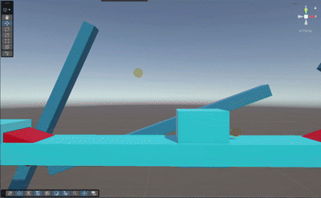

# Mini-level

**Naam:** Jahnairo Hanenberg
**Klas:** SD1C
**Datum:** 27-10-2026
**Les:** GDV Les 6

---

## Wat heb ik gemaakt?
Ik heb een simpele platformer gemaakt. Je moet alle munten verzamelen om te winnen.



---

## Bewegend object

<!-- Welk object beweegt en hoe heb je dat gedaan? -->

Deze script laat de speler bewegen springen en bewegen van links en rechts. Beweging deed ik door: een float en een rigidbodycomponent op te roepen en dan Vector3, Input.Axis, bijvoorbeeld te gebruiken en voor springen heb ik een Vector3 voor springen en een float voor hoe hoog die cube gaat en rb.AddForce gebruikt.

```csharp
public class CubeMove : MonoBehaviour
{
    public Vector3 jump;
    float moveSpeed = 8f;
    public float jumpForce = 2.0f;

    public bool isGrounded;
    Rigidbody rb;


    void Start()
    {
        rb = GetComponent<Rigidbody>();
        jump = new Vector3(0.0f, 2.0f, 0.0f);
    }

    void OnCollisionStay()
    {
        isGrounded = true;
    }

    void OnCollisionExit()
    {
        isGrounded = false;
    }

    void Update()
    {

        transform.Translate(Vector3.right * Time.deltaTime * Input.GetAxis("Horizontal") * moveSpeed);

        if (Input.GetKeyDown(KeyCode.Space) && isGrounded)
        {

            rb.AddForce(jump * jumpForce, ForceMode.Impulse);
            isGrounded = false;
        }
    }
}
```

---

## Collider of trigger

<!-- Welk object heeft een collider of trigger, en wat gebeurt er? -->

Als de speler wordt geraakt met de object/trigger killzone, gaat de speler terug naar de gegeven respawnpoint.

```csharp
private void OnTriggerEnter(Collider other)
{
    if (other.CompareTag("Player"))
    {
        player.transform.position = respawnPoint.transform.position;
        Physics.SyncTransforms();
    }
}
```

---

## Logica met `if` of `switch`

<!-- Beschrijf kort welke keuze je hebt gemaakt (bijv. sleutel → deur open). -->

Deze script zorgt ervoor dat je munten kan oprapen en optelt met een if statement.

```csharp
public class CountCoins2 : MonoBehaviour
{
    public int Coins = 0;

    void Start()
    {
        Debug.Log("Verzamel 10 Munten om te Winnen.");
    }

    private void OnTriggerEnter(Collider other)
    {
        if (other.CompareTag("Coin"))
        {
            Coins++;
            Debug.Log("Score: " + Coins );
        }

        if (Coins == 10)
        {
            Debug.Log("Gefeliciteerd, je hebt gewonnen!");
        }
    }
}
```

---

## Eigen extra idee

<!-- Wat is jouw eigen extra feature? Beschrijf wat het doet en hoe je het hebt gebouwd. -->

Dit is een camerascript die de speler x-axis volgt. Ik probeerde het zelf te bouwen met een deel van de spelerscript, maar ik wist niet hoe ik het correct kon laten volgen, dus heb ik deze script meer van het internet.

```csharp

using UnityEngine;

public class FollowX : MonoBehaviour
{
    public Transform target;

    public float speed = 0f;

    void Update()
    {
        if (target == null)
        {
            Debug.LogWarning("FollowX: No target assigned.");
            return;
        }


        Vector3 currentPos = transform.position;


        float newX;
        if (speed <= 0f)
        {

            newX = target.position.x;
        }
        else
        {

            newX = Mathf.MoveTowards(currentPos.x, target.position.x, speed * Time.deltaTime);
        }


        transform.position = new Vector3(newX, currentPos.y, currentPos.z);
    }
}
```
---

## Evaluatie

### Wat ging goed? en waarom?

Schrijven van wat makkelijke code, Ik vond sommige code zoals: munten, en de speler naar links en rechts laten bewegen niet te moeilijk.

Het bouwen van de level, ik had in blender geen probleemen met het bouwen en had het snel afgerond. 

### Wat vond je lastig? en waarom?

Bepalen wat het mini-level was, Ik had veel ideën, maar die waren te moeilijk of duurde te lang, maar uiteindelijk was ik wel op dit uitgekomen.

Het schrijfen van de meeste code, ik had het project die ik in mijn hoofd had best wel onderschat, want ik ging vaak op het internet en soms een beetje met ai opzoeken wat ik moest doen. De camera met de speler laten bewegen vond ik lastig en had daar wel wat tijd ingestoken om het goed laten te werken.

### Wat zou je een volgende keer anders doen?

Wat ik anders zou doen is: proberen om code schrijfen met minder hulp van lessen en internet en gewoon een makkelijker idee maken van dat ik weet dat ik het idee kan uitvoeren met minder hulp.
